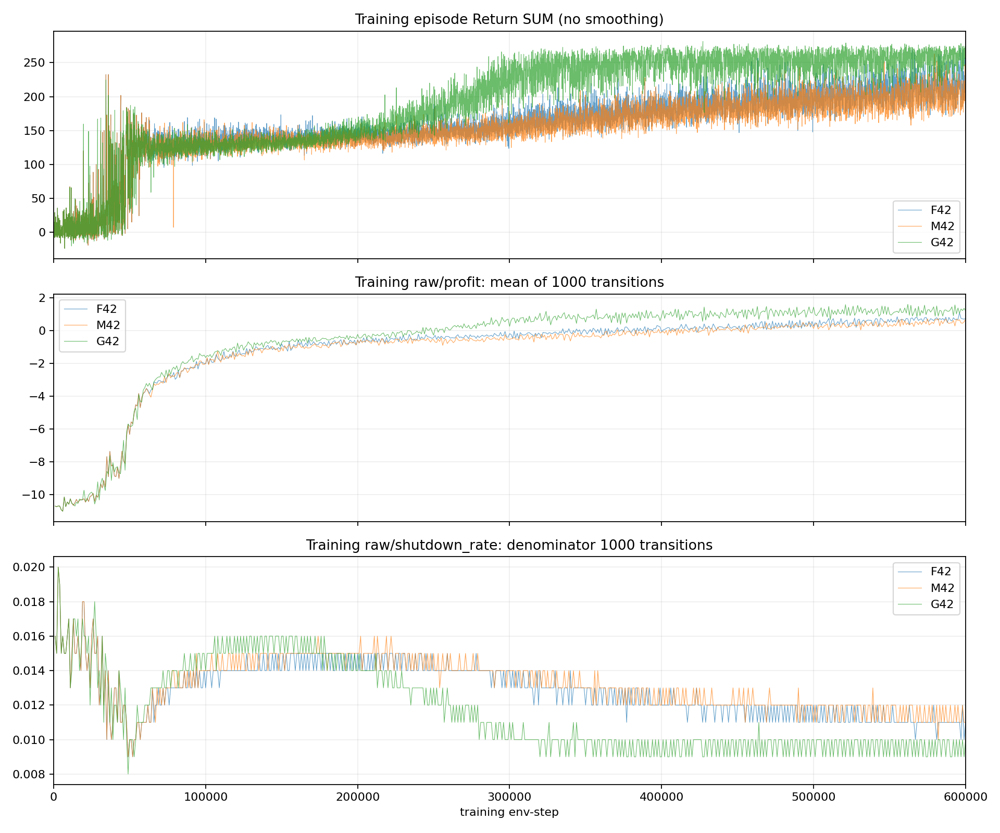
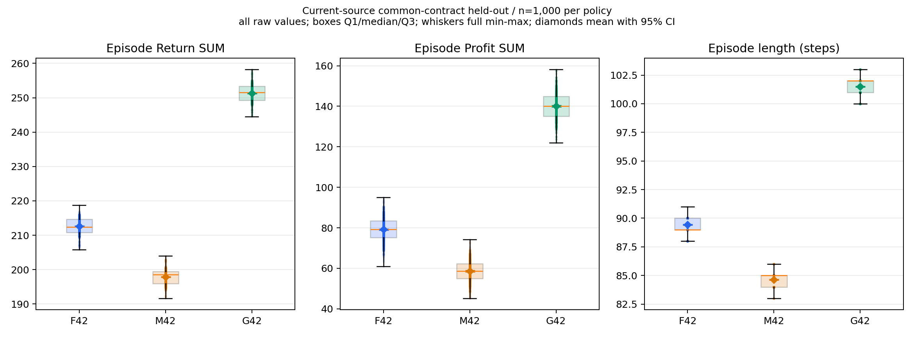

# Tennessee Eastman Process 기반 Multi-Agent Reinforcement Learning

Tennessee Eastman Process(TEP)에서 세 agent가 서로 다른 공정 정보를 관측하면서 협력 제어하는 Multi-Agent RL을 실험했습니다.

기본 모델에는 HHAC의 heterogeneous actor와 Behavior Intention(BI) 기반 critic 구조를 TEP의 연속 행동 환경에 맞게 적용했습니다. 이 프로젝트에서 제가 진행한 주요 작업은 FL 구조 재구성, 경제성 기반 reward 설계, Split PPO와 selective FedAvg 통합, privacy 실험 및 baseline 비교입니다.

## 1. 구조

HHAC의 actor는 type별 입력 처리층과 공유 representation 층을 조합합니다. 이 프로젝트에서는 공유 `obs_enhancer`에 선택적으로 FedAvg를 적용하도록 구성했습니다. Critic은 각 agent의 local observation과 이전 action으로 BI를 생성하고, 세 agent의 BI를 GAT으로 결합해 value를 계산합니다.

```text
Local observation
    ├── Actor: type-specific input layer
    │       → shared obs_enhancer (FedAvg)
    │       → action head → local action
    │
    └── Critic: + previous local action
            → BI encoder / GRU → GAT → value estimate
```

HHAC에서 가져온 모델 설계와 별개로 TEP 환경 wrapper, Split PPO 학습 과정, 공유 parameter 선택, 실험 및 평가 코드를 구현했습니다.

주요 코드: [Actor](models/fl_split_actor.py), [BI/GAT critic](models/fl_split_critic.py), [Split PPO trainer](trainers/fl_split_ppo_trainer.py), [FedAvg](utils/fedavg.py)

## 2. TEP 환경과 reward

실험에는 외부 `tep` simulator 2.5.0을 사용했습니다. 세 agent의 local observation 크기는 각각 7, 10, 8이며, 각자 하나의 manipulated variable을 제어합니다. Episode는 최대 300 RL step이고 한 step은 시뮬레이터 시간 60초입니다.

특정 setpoint 오차만 줄이는 대신 생산량과 공정 비용을 직접 고려하도록 경제성 기반 reward를 설계했습니다.

```text
profit_proxy = production - process_cost
reward = (profit_proxy - baseline) / scale
baseline = -11, scale = 5
# 따라서 reward = (profit_proxy + 11) / 5
```

`-11`은 reward 계산에서 빼는 기준값(baseline)이고, `profit_proxy`는 회계상 이익이 아니라 이 실험에서 정의한 값입니다. Profit proxy가 0이어도 살아 있는 step마다 reward `+2.2`가 쌓이므로 return은 경제적 성과와 episode length 모두의 영향을 받습니다.

그래서 결과를 비교할 때 return만 보지 않고 profit proxy, episode length와 shutdown 여부를 함께 확인했습니다. 환경과 reward 구현은 [환경 재현 문서](docs/REPRODUCIBILITY.md), [reward](envs/reward.py), [cost](envs/cost.py)에 정리되어 있습니다.

## 3. Baseline 비교 (IPPO, MAPPO, HAPPO)

Split + FedAvg를 IPPO, MAPPO, HAPPO와 같은 환경에서 비교했습니다. 각 방법을 training seed 42, 43, 44로 학습하고 seed마다 1,000 episode를 평가했습니다.

| Method | Profit proxy mean ± SD | Mean length | Mean return |
|---|---:|---:|---:|
| Split + FedAvg | 26.51 ± 32.85 | 72.06 | 163.83 |
| MAPPO | -137.94 ± 0.68 | 70.63 | 127.79 |
| HAPPO | -139.26 ± 1.17 | 71.07 | 128.51 |
| IPPO | -139.92 ± 0.66 | 71.51 | 129.34 |

`±`는 세 training seed에서 얻은 평균 profit proxy의 sample SD입니다. Split + FedAvg와 MAPPO의 return 차이는 약 36인데, episode length 차이에 따른 baseline 항은 약 3.1이고 profit proxy 차이를 reward 단위로 환산한 몫이 약 32.9입니다. 이 비교에서는 길이보다 profit proxy가 return 차이를 더 많이 설명합니다.

네 방법 모두 **평가 episode의 100%가 shutdown**으로 끝났습니다. 따라서 위 결과는 안정적인 공정 제어의 성공이 아니라 shutdown 전까지의 utility 비교입니다. IPPO, MAPPO, HAPPO의 9개 training run은 profit proxy가 대략 -137~-141, length가 70~72에 몰렸습니다. 현재 공개 자료에는 MV를 고정한 no-op baseline이 없어, 학습된 정책이 단순 고정 제어보다 나은지는 판단할 수 없습니다.

Fully Centralized PPO도 별도 baseline으로 구현했지만 위 네 방법의 집계표에는 포함하지 않았습니다.

결과: [Baseline aggregate](results/baselines/final_utility_method_aggregate.csv), [Fully Centralized PPO 코드](trainers/fully_centralized_ppo_trainer.py)

## 4. Value path 입력 비교 (F/M/G)

Actor는 모두 local observation으로 행동하게 두고 BI/value path의 입력만 바꿨습니다.

| Variant | BI 입력 | 비교 목적 |
|---|---|---|
| F | 자신의 local observation | 기본 조건 |
| M | 25D joint layout, 다른 agent 관측값은 0 | 입력 형태 변화의 영향 |
| G | 전체 normalized 25D joint observation | 추가 정보의 영향 |

M은 F와 같은 정보만 사용하지만 G와 입력 차원은 같습니다. F 모델에서 M/G의 공통 parameter를 이식하고 추가된 foreign-observation weight를 0으로 초기화했습니다. 이 weight는 이후 학습 가능합니다.

각 variant는 training seed 42 하나로 학습했고, 동일한 held-out evaluation seed 1,000개(2000~2999)를 사용했습니다.

| Variant | Mean profit proxy | Mean length | Mean return |
|---|---:|---:|---:|
| F | 79.16 | 89.45 | 212.62 |
| M | 58.62 | 84.63 | 197.90 |
| G | 140.07 | 101.51 | 251.33 |





M은 F와 정보량이 같은데도 profit proxy가 약 20.5 낮았습니다. 입력 형태 자체가 결과에 영향을 준 것입니다.

G는 F보다 return이 약 38.7 높고 episode가 약 12.1 step 길었습니다. 이 return 차이는 reward 식을 기준으로, 추가 생존 step에서 발생한 baseline 항 약 26.5와 누적 profit proxy 차이 `60.91 / 5 ≈ 12.2`로 나뉩니다. Shutdown을 늦춘 것도 제어상 의미가 있을 수 있지만 원인이 추가 관측 정보인지 단정할 수는 없습니다. 원인을 구분하기 어려운 이유는 같은 Split + FedAvg 계열에서도 training seed만 바뀌어 profit proxy가 약 -1.6~72.6, episode length가 61~90까지 달라졌기 때문입니다. 게다가 F/M/G의 **총 3,000 held-out episode는 전부 shutdown**으로 끝났습니다. 현재로서는 value path 입력을 바꾸면 정보를 늘리지 않아도 결과가 움직일 수 있고, G의 이점이 global information 때문인지 seed 하나로는 분리하기 어렵습니다.

## 5. BI privacy (DRAVL 적용)

BI를 공유하면 local observation 정보를 재구성할 수 있을지 확인하고, DRAVL의 세 privacy 방법을 BI representation에 적용했습니다.

- Adversarial Reconstruction (AR)
- Noise Regularization (NR)
- Distance Correlation (dCor)

NR에서는 reconstructor를 고정하고 BI encoder를 학습시켜 reconstructor 출력이 원래 관측값보다 random noise에 가까워지도록 합니다.

초기에는 detached BI에서 reconstructor만 학습하는 실험을 진행했는데, probe 결과의 변화가 BI 자체의 변화를 뜻하지는 않았습니다. 이후에는 reconstructor를 먼저 업데이트하고 privacy gradient를 BI encoder로 전달하는 full trainer를 구성했습니다. 현재 공개된 결과만으로 privacy 개선량과 utility 비용을 신뢰할 수 있는 하나의 수치로 정리하기는 어려워 대표 성과로 제시하지 않았습니다.

코드: [Privacy module](models/bi_privacy_defense.py), [Full privacy trainer](trainers/fl_split_ppo_trainer_privacy_full.py)

## 남은 한계와 다음 실험

다시 평가한다면 training seed를 조건당 최소 3개 이상 반복하고, MV-fixed no-op 기준선을 추가하고, return보다는 shutdown 시점과 episode survival, profit proxy를 주요 지표로 보겠습니다. 현재 결과는 모델의 utility 차이를 보여주지만 안정적인 공정 제어를 입증하지는 못했습니다.

## Reproducibility

TEP simulator는 이 repository에 포함하지 않았습니다. 환경 버전, dependency, 실험 entry point와 재현 범위는 [REPRODUCIBILITY.md](docs/REPRODUCIBILITY.md)에 정리했습니다.

## References

1. T. Hu et al., [*Hybrid Actor-Critic for Physically Heterogeneous Multiagent Reinforcement Learning*](https://doi.org/10.1109/TCDS.2025.3570497), IEEE Transactions on Cognitive and Developmental Systems, 17(6), 1520–1535, 2025.
2. J. Sun et al., [*Defending against Reconstruction Attack in Vertical Federated Learning*](https://arxiv.org/abs/2107.09898), FL-ICML'21 Workshop, 2021.
